<a href="https://zyria.site">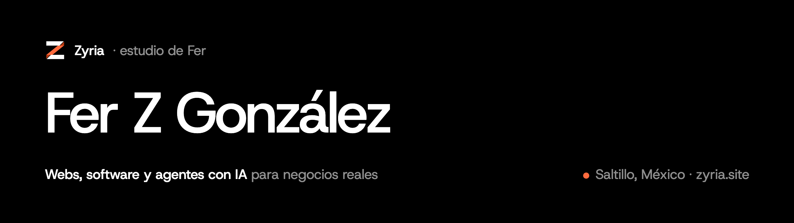</a>

Estudio Ingeniería en IA y Ciencia de Datos en el **Tec de Monterrey**, campus Saltillo, y llevo **[Zyria](https://zyria.site)**, mi estudio de webs y software para negocios.

Yo defino qué se hace y cómo se ve, y lo pruebo con el cliente. El código lo escribo con agentes de IA. Casi todo lo que hay aquí está en producción o se usó para cerrar un cliente.

**[zyria.site](https://zyria.site)** · **[Instagram](https://instagram.com/zyria.site)** · **[WhatsApp](https://wa.me/528445884774)**

Next.js · TypeScript · Supabase · Tailwind · Claude API · Vercel

---

### Productos propios

<table>
<tr>
<td width="50%" valign="top">
<a href="https://www.zoft.dev">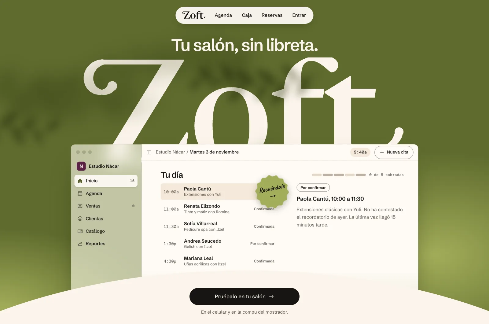</a>
 <b>Zoft</b> · Software de citas
 Agenda, caja y reservas en línea para salones de belleza. Nació para que un salón deje Fresha sin cambiar su forma de trabajar.
 <a href="https://www.zoft.dev">zoft.dev</a>
</td>
<td width="50%" valign="top">
<a href="https://zyria.site/menus/">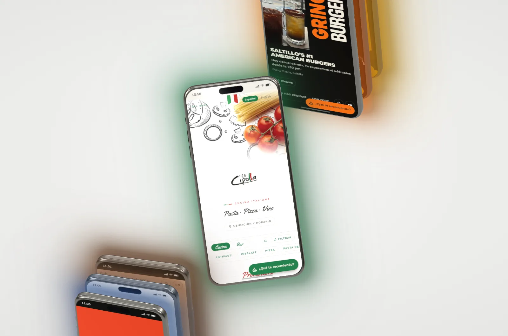</a>
 <b>Antojo</b> · Menús digitales
 Menús digitales para restaurantes, cada uno con el diseño de su marca y un mesero con IA que recomienda platillos.
 <a href="https://zyria.site/menus/">Ver los menús</a>
</td>
</tr>
<tr>
<td width="50%" valign="top">
<a href="https://telar-sarape.vercel.app">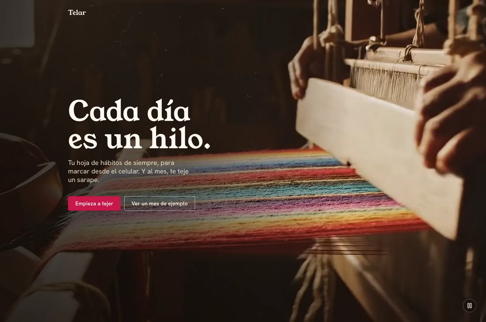</a>
 <b>Telar</b> · App de hábitos
 Cada día es un hilo y al terminar el mes la app te teje un sarape de Saltillo.
 <a href="https://telar-sarape.vercel.app">Abrir la app</a> · <a href="https://github.com/ferzglzb/telar">Código</a>
</td>
<td width="50%" valign="top">
<a href="https://zyria.site/invitaciones/valeria-y-daniel/">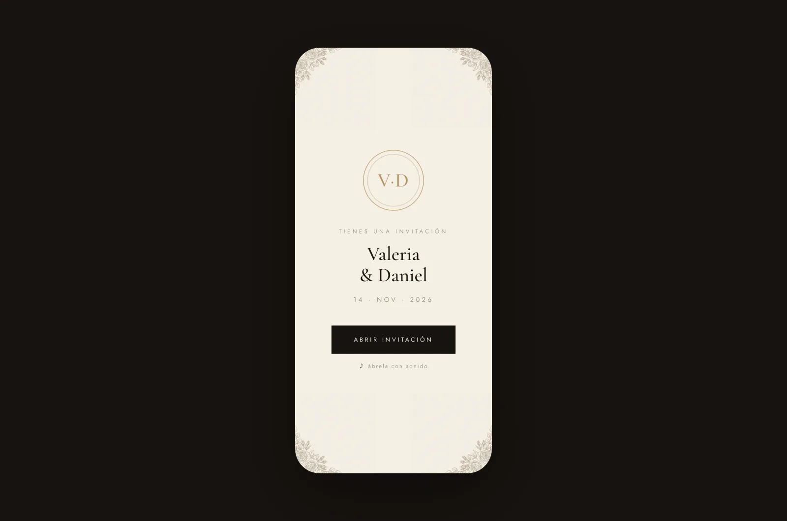</a>
 <b>Velada</b> · Invitaciones digitales
 Invitaciones que se abren como una película corta, con música, animación y confirmación de asistencia.
 <a href="https://zyria.site/invitaciones/valeria-y-daniel/">Ver una invitación</a>
</td>
</tr>
</table>

### Para clientes

<table>
<tr>
<td width="50%" valign="top">
<a href="https://metalmaster-drab.vercel.app">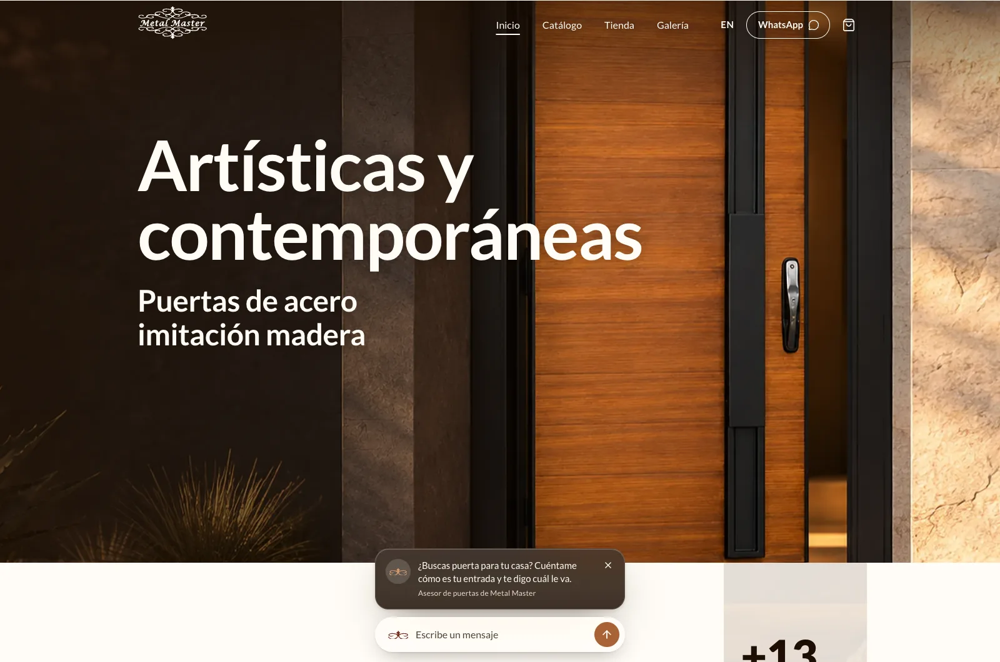</a>
 <b>Metal Master</b> · Tienda en línea · Piedras Negras
 Tienda de puertas de acero: armas tu puerta, la pruebas en la foto de tu casa y un asesor con IA te recomienda.
 <a href="https://metalmaster-drab.vercel.app">Sitio</a>
</td>
<td width="50%" valign="top">
<a href="https://vivo-market-maqueta.vercel.app">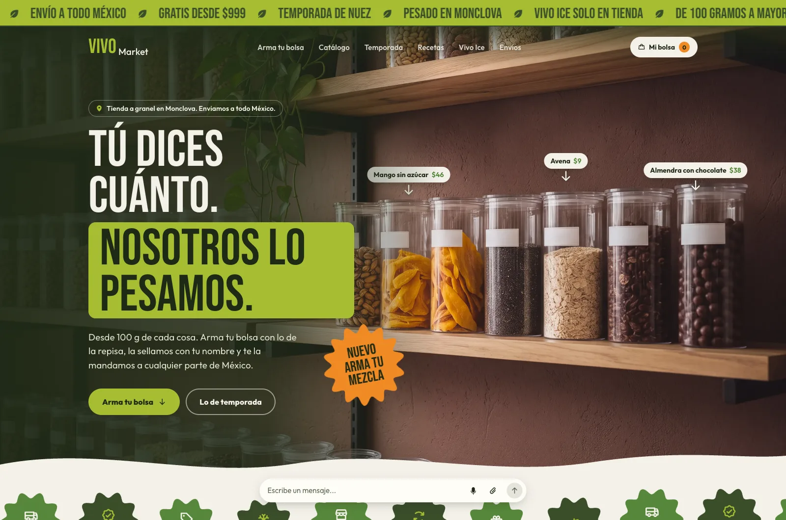</a>
 <b>Vivo Market</b> · Tienda en línea · Monclova
 Tienda a granel donde armas tu bolsa desde 100 g, con un asesor que recomienda.
 <a href="https://vivo-market-maqueta.vercel.app">Sitio</a> · <a href="https://github.com/ferzglzb/vivo-market">Código</a>
</td>
</tr>
<tr>
<td width="50%" valign="top">
<a href="https://modificar.vercel.app">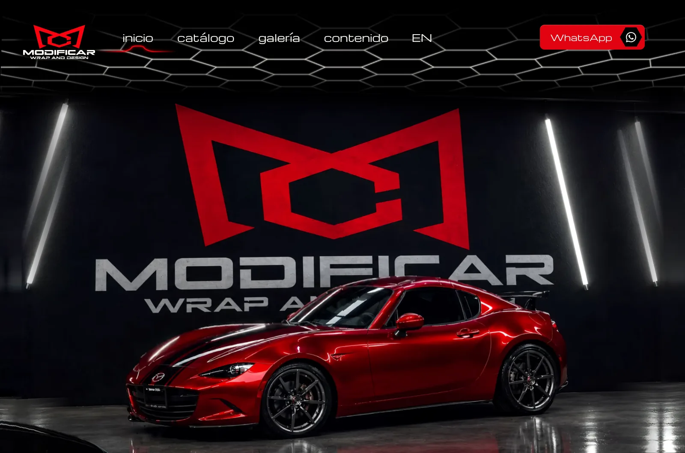</a>
 <b>ModifiCar</b> · Sitio web · Saltillo
 Sitio para un taller de vinil y wrap automotriz, en español e inglés, con panel para el dueño.
 <a href="https://modificar.vercel.app">Sitio</a> · <a href="https://github.com/ferzglzb/modificar">Código</a>
</td>
<td width="50%" valign="top">
<a href="https://casacanina-demo.vercel.app/prueba-kit">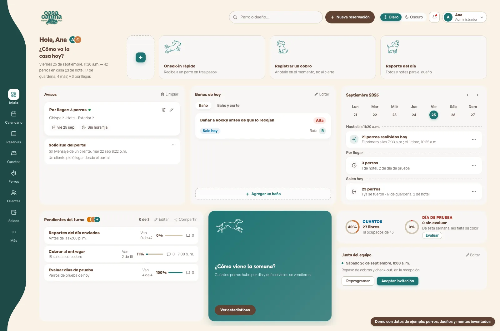</a>
 <b>Casa Canina</b> · Software a la medida · Saltillo
 Sistema de una guardería y hotel de perros: reservas, cuartos, cobros y reportes. El código es privado; la demo usa datos de ejemplo.
 <a href="https://casacanina-demo.vercel.app/prueba-kit">Demo</a>
</td>
</tr>
<tr>
<td width="50%" valign="top">
<a href="https://cafe-heroes.vercel.app">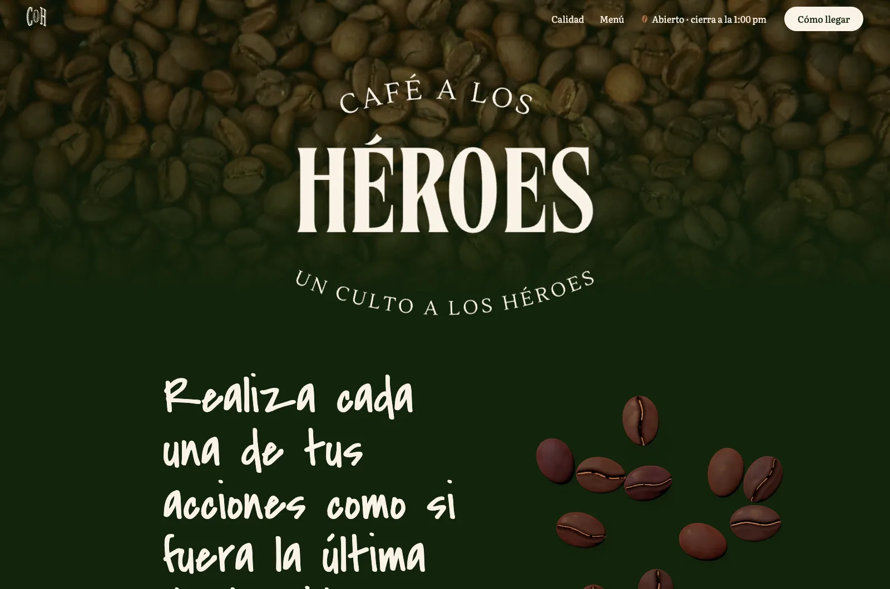</a>
 <b>Café a los Héroes</b> · Sitio web · Monclova
 Sitio de una cafetería con su carta y el horario del día.
 <a href="https://cafe-heroes.vercel.app">Sitio</a> · <a href="https://github.com/ferzglzb/cafe-heroes">Código</a>
</td>
<td width="50%" valign="top">
<a href="https://anka-web-mu.vercel.app">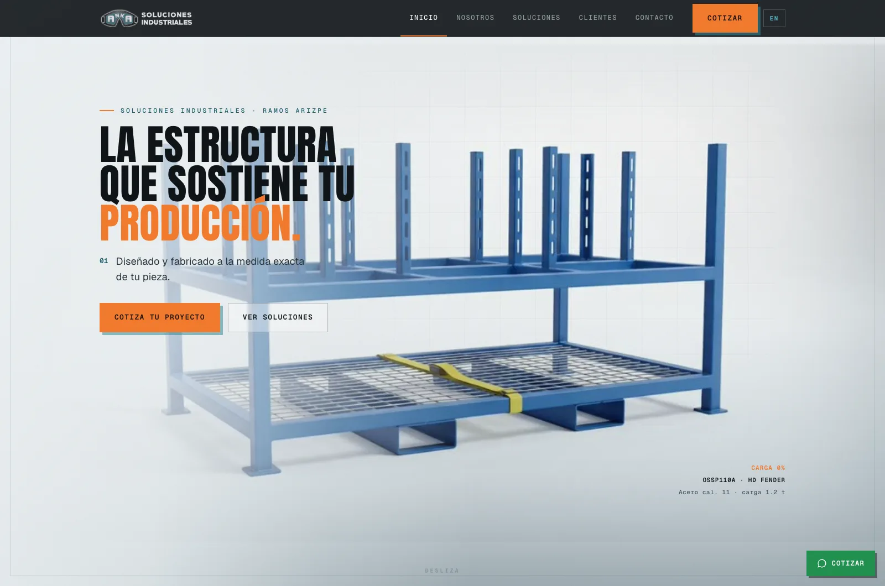</a>
 <b>ANKA Soluciones Industriales</b> · Sitio web · Ramos Arizpe
 Sitio de un fabricante de racks y contenedores industriales, en español e inglés.
 <a href="https://anka-web-mu.vercel.app">Sitio</a> · <a href="https://github.com/ferzglzb/anka-web">Código</a>
</td>
</tr>
<tr>
<td width="50%" valign="top">
<a href="https://synergym-web.vercel.app">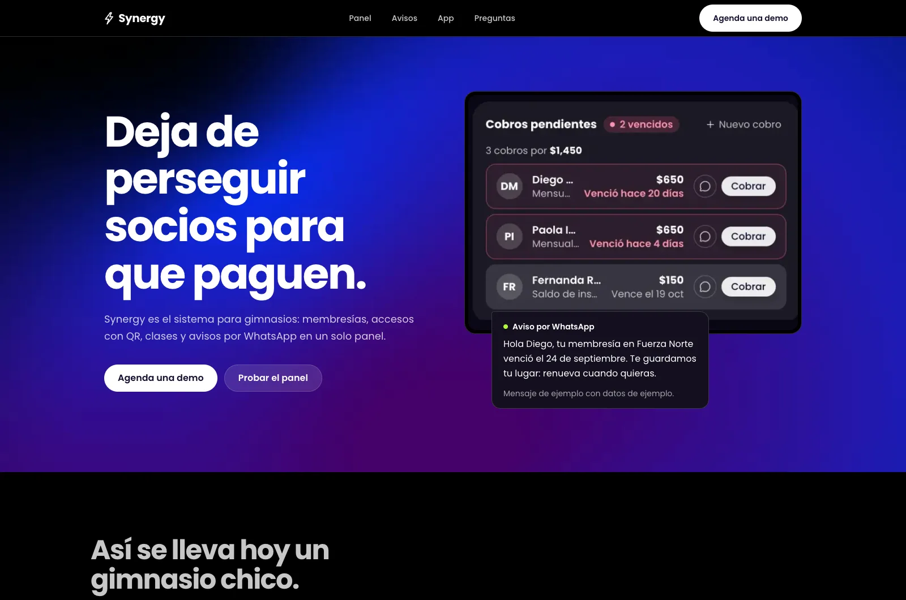</a>
 <b>Synergy</b> · Página de venta
 Página de un sistema para gimnasios: membresías, accesos con QR y avisos de cobro.
 <a href="https://synergym-web.vercel.app">Sitio</a>
</td>
<td width="50%" valign="top">
<a href="https://kg-karat.vercel.app">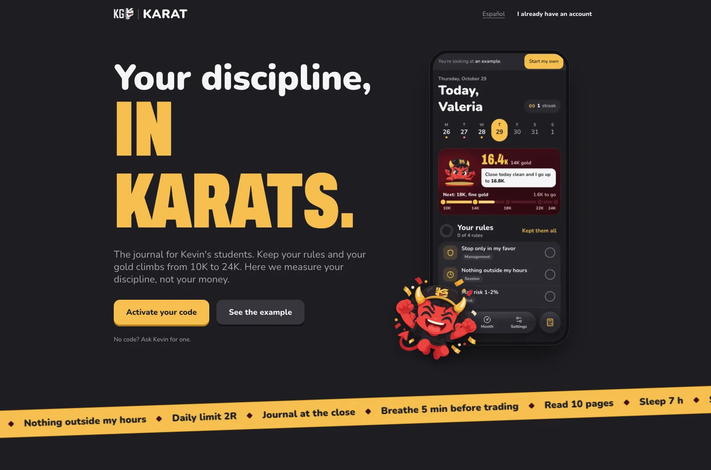</a>
 <b>KG Karat</b> · App
 Journal de disciplina para los alumnos de un trader de oro, con acceso de pago por código.
 <a href="https://kg-karat.vercel.app">Abrir la app</a>
</td>
</tr>
</table>

### Propuestas

Demos completas que armé para enseñarle a un negocio cómo se vería, antes de que tuviera que imaginárselo.

<table>
<tr>
<td width="50%" valign="top">
<a href="https://littlefarm-saltillo.vercel.app">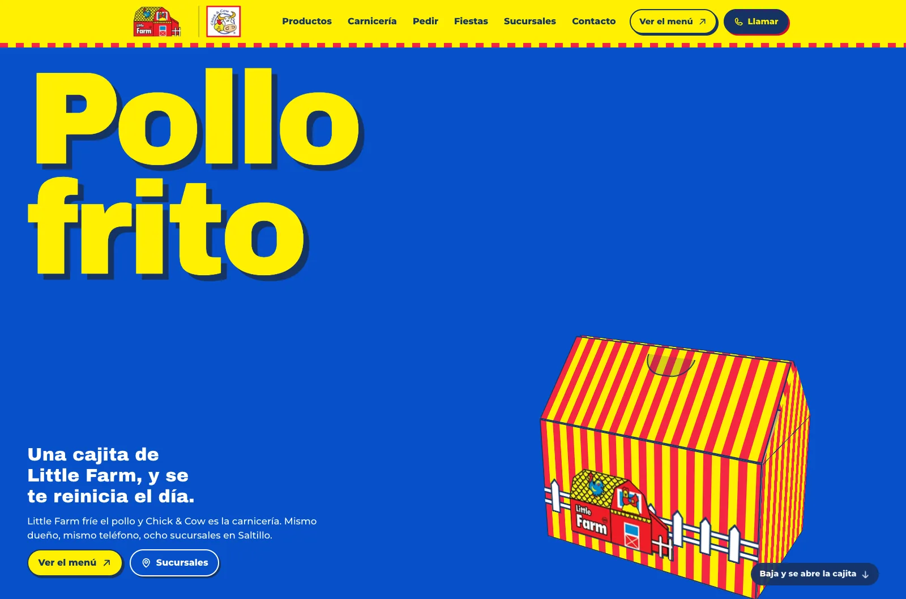</a>
 <b>Little Farm y Chick & Cow</b> · Sitio web · Saltillo
 Pollo frito y carnicería con pedidos para recoger y ocho sucursales en el mapa.
 <a href="https://littlefarm-saltillo.vercel.app">Sitio</a>
</td>
<td width="50%" valign="top">
<a href="https://elenora-flame.vercel.app">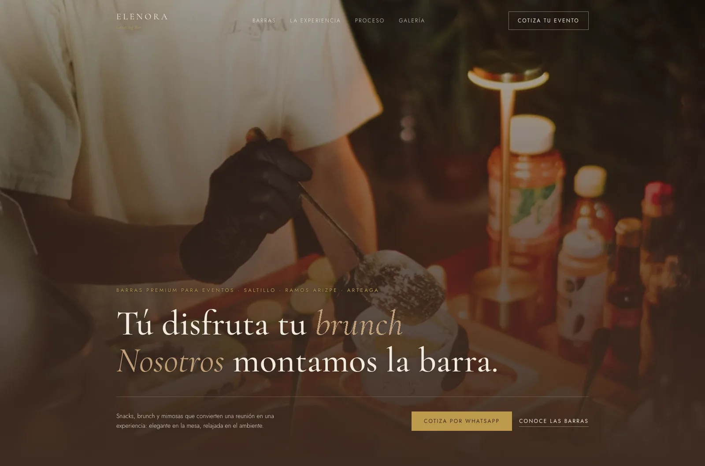</a>
 <b>Elenora Catering Bar</b> · Sitio web · Saltillo
 Catering de barras de snacks, brunch y mimosas para eventos.
 <a href="https://elenora-flame.vercel.app">Sitio</a>
</td>
</tr>
</table>

### Herramientas

- **[Isla](https://github.com/ferzglzb/isla)**: convierte el notch de la MacBook en algo útil. Ventanas, notas, calendario, música y portapapeles en la isla. Swift, AppKit y SwiftUI, sin Xcode.
- **[sapal-stl](https://github.com/ferzglzb/sapal-stl)**: genera ruedas STL paramétricas para impresión 3D y repara la malla para que salga cerrada. Python y numpy.

---

Más proyectos, videos y menús en <a href="https://zyria.site"><b>zyria.site</b></a>

